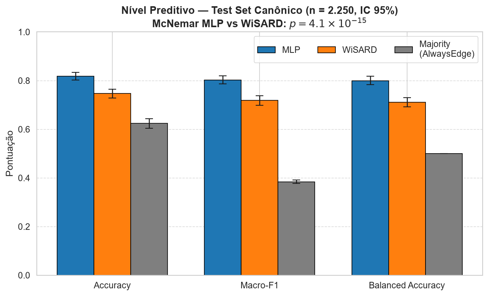
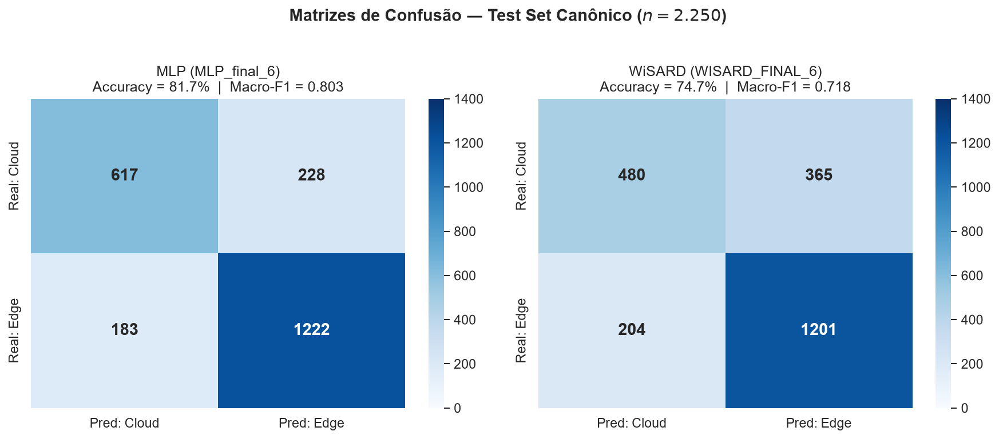
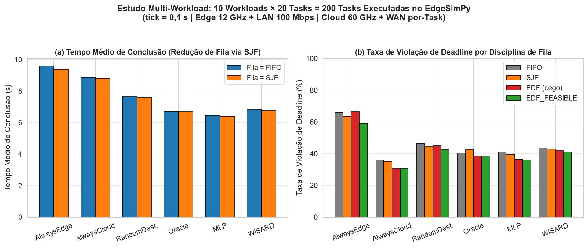

# Edge/Cloud Task Offloading with Neural Networks

**Learning where to run a computation — on a nearby Edge server or in the Cloud — with a
from-scratch MLP and a Weightless Neural Network (WiSARD), validated end-to-end in a
discrete-event simulator (EdgeSimPy).**

> Undergraduate thesis (TCC) project. Documentation of the thesis itself is in Portuguese
> (`docs/tcc/`); this README is the technical overview. *Resumo em PT-BR no final.*



---

## TL;DR

| | |
|---|---|
| **Problem** | Binary decision per task (`Edge` vs `Cloud`) to minimise response time and deadline misses under compute/network constraints. |
| **Models** | Multi-Layer Perceptron and WiSARD weightless neural network, **both implemented from scratch** (NumPy in Python, pure C# with zero NuGet dependencies). |
| **Data** | 15,000 synthetic tasks, stratified 70/15/15 train/validation/test split, fixed seeds. |
| **Predictive result** (held-out test, n = 2,250) | MLP **0.817 accuracy / 0.803 macro-F1** · WiSARD 0.747 / 0.718 · majority baseline 0.624 / 0.384. MLP > WiSARD, exact McNemar *p* = 4·10⁻¹⁵. |
| **System-level result** (EdgeSimPy, 10 workloads × 20 tasks) | MLP mean completion time **6.40 s**, matching the analytical oracle (6.69 s) and **~32 % faster than Always-Edge** / ~27 % faster than Always-Cloud. |
| **Engineering** | Train/serve parity verified on all 2,250 test samples (0 mismatches), leakage-aware feature contract, pre-registered model selection, 95 % bootstrap CIs. |

---

## Why this project is interesting

Most offloading papers stop at *classifier accuracy*. This project treats the model as a
**decision policy inside a running system** and asks the harder question: *does a better
classifier actually produce a better system?*

To answer it honestly the project is split into three independent stages, so that the formula
that generates the labels is never the same thing that grades the policy:

```
 (A) Label generation           (B) Model training               (C) Independent evaluation
 ─────────────────────          ─────────────────────            ──────────────────────────
 C# analytical latency   ──►    MLP / WiSARD on a 6-feature ──►  EdgeSimPy discrete-event
 model → BestDestination        causal contract (Python)         simulation: queues, network
 (15k synthetic tasks)          frozen artifacts (.npz/.json)    flows, ticks, deadlines
```

---

## Machine-learning highlights

### 1. Neural networks implemented from first principles
No scikit-learn / PyTorch for the models — every component is written and tested by hand, in two
languages, and cross-checked for numerical parity.

**MLP** — [`edgesimpy-simulation/src/ml/mlp_model.py`](edgesimpy-simulation/src/ml/mlp_model.py) ·
[`Strategies/Mlp/MlpStrategy.cs`](Strategies/Mlp/MlpStrategy.cs)
- 6 → 18 → 1 architecture, sigmoid activations, binary cross-entropy gradient (`output − y`).
- Manual **backpropagation** with online SGD (lr 0.04, 35 epochs, per-epoch shuffling).
- **Xavier/Glorot** initialisation, numerically stable sigmoid (clamped logits).
- Min-max normalisation **fitted on the training split only**; parameters serialised with the
  weights so the deployed policy reproduces training-time preprocessing exactly.

**WiSARD (Weightless Neural Network)** — [`edgesimpy-simulation/src/ml/wisard_model.py`](edgesimpy-simulation/src/ml/wisard_model.py) ·
[`Strategies/Wisard/WisardStrategy.cs`](Strategies/Wisard/WisardStrategy.cs)
- RAM-based discriminators (one per class) with a seeded random input-to-RAM mapping.
- **Thermometer vs. binary encoding**: diagnosed that positional binary codes break the address
  locality WiSARD needs to generalise (`0111` vs `1000`); thermometer coding fixed it.
- **Bleaching** (count-based RAMs with an increasing activation threshold) to resolve ties.
- Fully vectorised scoring in NumPy.

### 2. Rigorous, leakage-aware ML methodology
- **Feature contract with an explicit forbidden list**
  ([`ml/dataset.py`](edgesimpy-simulation/src/ml/dataset.py)): any field computed *after* the
  decision (execution times, completion/queue times, the label itself) is rejected at load time.
- **Causal feature selection**: the original feature set leaked simulator state and included a
  non-causal `DeadlineMs`. A formula audit
  ([`auditoria_formula_analitica.md`](edgesimpy-simulation/results/auditoria_formula_analitica.md))
  led to a 6-feature set observable in EdgeSimPy at decision time
  (`CpuCycles, TaskSizeMB, LatencySensitivity, RequiredMemoryMB, BandwidthMbps, NetworkLatencyMs`),
  which *raised* test accuracy from ~0.73 to ~0.82.
- **Proper train / validation / test discipline**: all tuning on validation; the test split was
  opened exactly once for the final report
  ([`final_test_evaluation.md`](edgesimpy-simulation/results/final_test_evaluation.md)).
- **Pre-registered hyperparameter search for WiSARD**: 72 configurations × 5 mapping seeds = 360
  trainings, selected by macro-F1 (accuracy is misleading under the 62/38 class prior) —
  macro-F1 **0.395 → 0.738**, tie rate 82 % → 0 %
  ([`wisard_tuning.md`](edgesimpy-simulation/results/wisard_tuning.md)).
- **Statistics, not single numbers**: percentile-bootstrap 95 % CIs (2,000 resamples), exact
  McNemar test for paired model comparison, seed-sensitivity analysis, validation→test shift check.

### 3. ML-in-production concerns
- **Train/serve parity**: the EdgeSimPy policy builds its feature vector from live simulation
  state (`Task` + network topology). A parity audit found and fixed a **double-normalisation bug**
  that made the deployed MLP predict Edge 100 % of the time — a classic serving skew. Parity tests
  now assert `policy(task) == model(X)` on the full test set (0 mismatches for both models).
- **Frozen, versioned artifacts**: `models/mlp_final_6.npz` (weights) + `.json` (config + scaler).
- **Policy/execution separation**: models only decide `Edge | Cloud`; server selection and
  execution are delegated to the simulator layer, so policies are swappable.

---

## Results

### Predictive performance (held-out test set, n = 2,250)

| Model | Accuracy [95 % CI] | Macro-F1 [95 % CI] | Balanced acc. | Recall Cloud |
|---|---|---|---|---|
| **MLP** | **0.817** [0.802, 0.833] | **0.803** [0.787, 0.820] | **0.800** | 0.730 |
| WiSARD | 0.747 [0.729, 0.764] | 0.718 [0.698, 0.737] | 0.711 | 0.568 |
| Majority (Edge) | 0.624 | 0.384 | 0.500 | 0.000 |



### System-level performance (EdgeSimPy, 10 independent workloads × 20 tasks)

Edge: 12 GHz + 100 Mbps LAN · Cloud: 60 GHz + per-task WAN · tick = 0.1 s · 6 destination
policies × 4 queue disciplines = 240 simulations.

| Destination policy | Mean completion (s), SJF queue | Deadline violation, EDF_FEASIBLE queue |
|---|---:|---:|
| Always-Edge | 9.37 ± 4.43 | 59.0 % ± 8.1 % |
| Always-Cloud | 8.81 ± 6.25 | **30.5 % ± 11.2 %** |
| Random | 7.58 ± 5.21 | 42.5 % ± 10.1 % |
| Analytical oracle | 6.69 ± 4.55 | 38.5 % ± 7.1 % |
| **MLP** | **6.40 ± 5.09** | 36.0 % ± 12.0 % |
| WiSARD | 6.75 ± 4.77 | 41.0 % ± 10.5 % |



**Takeaways**
- The learned policies cut mean completion time substantially versus static and random baselines
  and track the analytical oracle.
- Accuracy is not the whole story: Always-Cloud has the *lowest* deadline-violation rate in this
  scenario, because the oracle label optimises latency, not deadlines. This is reported as a
  finding, not hidden — it motivates deadline-aware labels as future work.
- Scheduling matters as much as placement: **SJF** reduces queueing time by 18–31 % for every
  policy, and the proposed **`EDF_FEASIBLE`** discipline (EDF that demotes tasks whose deadline is
  already infeasible) gives the lowest violation rate for all six destination policies.

All numbers above come from versioned reports in
[`edgesimpy-simulation/results/`](edgesimpy-simulation/results/).

---

## Repository layout

```
.
├── Program.cs, Dataset/, DatasetGenerator/,      C# analytical simulator (.NET 10, no NuGet deps)
│   Simulation/, Strategies/, Evaluation/,         ├─ synthetic dataset + latency model (labels)
│   Reports/                                       └─ Random, FixedRule, Heuristic, WiSARD, MLP
├── edgesimpy-simulation/                         Python validation layer
│   ├── src/ml/                                    MLP, WiSARD, preprocessing, metrics, dataset contract
│   ├── src/policies/                              ML offloading policies + placement baselines
│   ├── src/execution/, src/integration/           Task queue/scheduler (FIFO/SJF/EDF/LLF/EDF_FEASIBLE),
│   │                                              network flows, Cloud executor, EdgeSimPy wiring
│   ├── src/experimento_*.py                       reproducible experiments (one script per study)
│   ├── src/test_*.py                              parity / scheduler / network tests
│   ├── models/                                    frozen MLP artifact
│   └── results/                                   reports (.md/.json) and figures
├── notebooks/analise_exploratoria.ipynb          exploratory data analysis
└── docs/                                         design notes, phase history, thesis (docs/tcc/)
```

---

## Quick start

**Requirements:** .NET 10 SDK, Python 3.12.

### C# analytical simulator (dataset + baseline policies)

```bash
dotnet run --project EdgeCloudOffloadingTcc.csproj          # 15,000 samples (default)
dotnet run --project EdgeCloudOffloadingTcc.csproj 20000    # custom size
```
Produces `Dataset/*.csv`, `Charts/*.png` and `Reports/final-report.md`.

### Python / EdgeSimPy layer

```bash
cd edgesimpy-simulation
python -m venv .venv
.venv\Scripts\pip install -r requirements.txt               # pins EdgeSimPy 1.1.0 by commit

# Tests (standalone scripts, run from edgesimpy-simulation/)
.venv\Scripts\python.exe src\test_ml_models.py
.venv\Scripts\python.exe src\test_mlp_policy_parity.py
.venv\Scripts\python.exe src\test_wisard_policy_parity.py
.venv\Scripts\python.exe src\test_queue_policies.py

# Key experiments
.venv\Scripts\python.exe src\experimento_tuning_wisard.py           # WiSARD hyperparameter search
.venv\Scripts\python.exe src\experimento_avaliacao_test_set.py      # final test-set evaluation
.venv\Scripts\python.exe src\experimento_multi_workload_sistemico.py # 240-simulation system study
.venv\Scripts\python.exe src\gerar_figuras_tcc.py                   # regenerate figures
```

Seeds are fixed throughout (dataset 42, split 43, MLP 11, WiSARD mapping 7, bootstrap 2026, workloads
`20261001..20261010`). Units are explicit: the C# layer uses milliseconds, the Python layer
seconds (`deadline_time_s = creation_time_s + deadline_ms / 1000`).

---

## Limitations (stated, not hidden)

- Labels come from an analytical formula; agreement with it reproduces that formula and is not
  proof of physical optimality — which is exactly why stage (C) exists.
- Workloads are synthetic and all tasks arrive at `t = 0`; the Cloud is modelled as a single
  logical node.
- The C# layer's own evaluation (`Reports/`) is preliminary: its 12-feature vector includes
  simulator state used to compute the label (feature leakage). The definitive results are the
  EdgeSimPy ones above.

## Further reading

- [`docs/tcc/ARTIGO_TCC_COMPLETO.md`](docs/tcc/ARTIGO_TCC_COMPLETO.md) — full thesis article (PT-BR)
- [`docs/tcc/GUIA_DIDATICO_TCC.md`](docs/tcc/GUIA_DIDATICO_TCC.md) — didactic guide to every concept used (PT-BR)
- [`docs/HISTORICO_EVOLUCAO_EDGESIMPY_TCC.md`](docs/HISTORICO_EVOLUCAO_EDGESIMPY_TCC.md) — detailed log of all 25 development phases and decisions
- [`docs/EDGE_SIM_PY_PHASES.md`](docs/EDGE_SIM_PY_PHASES.md) — phase summary
- [`edgesimpy-simulation/results/PARITY_AUDIT_REPORT.md`](edgesimpy-simulation/results/PARITY_AUDIT_REPORT.md) — train/serve parity audit

---

### Resumo (PT-BR)

TCC que compara políticas de decisão de *task offloading* Edge/Cloud. Uma MLP e uma rede neural
sem peso (WiSARD), implementadas do zero, são treinadas sobre um contrato de 6 features causais
e avaliadas em dois níveis: preditivo (test set isolado, IC95 % por bootstrap, McNemar) e
sistêmico (simulação de eventos discretos no EdgeSimPy com filas, rede e deadlines). A MLP
atinge 0,817 de acurácia e reduz o tempo médio de conclusão em ~32 % frente a "sempre Edge".
Documentação completa do TCC em [`docs/tcc/`](docs/tcc/).

## License

See [LICENSE](LICENSE).
